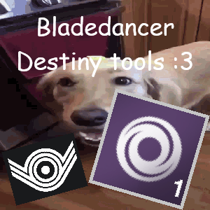

# Bladedancer's Destiny Tools

## https://destinytools.bladedancer.net/



Additional info (technical, scope and other) are located in the [docs](./docs) directory.

## Local installation

### Prerequisites 

- GNU Make
- Docker desktop

Ubuntu/Debian based Distros:
```bash
sudo apt-get install make
```

Docker desktop is recommended as it comes with all the necessary tools used to run containers

Linux based systems: https://docs.docker.com/desktop/setup/install/linux/

### Register the application with Bungie

Create a new application at https://www.bungie.net/en/Application (while logged in with a bungie.net account):

- Give a name to your application, can be any (it's going to be the name that shows up when logging in for the 1st time through bungie.net)
- Set **Application status** to `private`
- Set **OAuth Client Type** to `Confidential`
- Set **Redirect URL** to : 
```
https://localhost/api/auth/callback
```
- Set **Scope** to the following :
  -  Read your Destiny 2 information (Vault, Inventory, and Vendors), as well as Destiny 1 Vault and Inventory data.
  -  Move or equip Destiny gear and other items.

### Local environment


Create the `.env` file and  edits its content

```bash
cp .env.example .env
```

Fill the following variables in the file: 
- `BUNGIE_API_KEY` (from the bungie.net application page)
- `CLIENT_ID` (from the bungie.net application page)
- `CLIENT_SECRET` (from the bungie.net application page)
- `SESSION_SECRET`
  - Generate it with:
```bash
openssl rand -hex 32
```

### Starting the application

```bash
make start
```

You can now access the application at: https://localhost/

## Production deployment

### Server prerequisites

- GNU Make
- Docker with the Compose plugin (`docker compose version`)
- A domain name pointing to the production server's IP
- **Ports 80 and 443 reachable from the internet**, make sure you allow trafic through your firewall

### Register the prod application with Bungie

[Register the application with Bungie](#register-the-application-with-bungie)

Same steps but set the **Redirect URL** to :
```
https://[your domain]/api/auth/callback
```

### Production environnement

Create the `.env` file and  edits its content

```bash
cp .env.production.example .env
```

On top of the [Local environnement](#local-environment) variables, fill the following variables as well:
- `APP_DOMAIN`
- `ACME_EMAIL`
- `POSTGRES_PASSWORD`
  - Generate it with: `openssl rand -hex 32`

### Start the production application

```bash
make prod-cold-start
```

It will build the required containers and launch the application after it is finished.

### Update the production application

Update the application and restarts all containers with :

```bash
make prod-update
```

If you only want to update the Next.js container run :

```bash
make prod-update-next
```

## Repository layout

- root — Docker and environment info:
- `src/` — the Next.js application
- `docs/` — technical notes, specifications and other stuff

## Stack

- **Next.js 16** (App Router, Turbopack) + **TypeScript** + **React 19**
- **Prisma** + **PostgreSQL** — server-side loadout storage
- **Dexie** / IndexedDB — Destiny manifest cache
- **TanStack Query** + **Zustand** — API cache and client state
- **Sass / SCSS**, **Floating UI**, **next-intl**
- **Caddy** as the HTTP handler and reverse proxy (HTTPS)